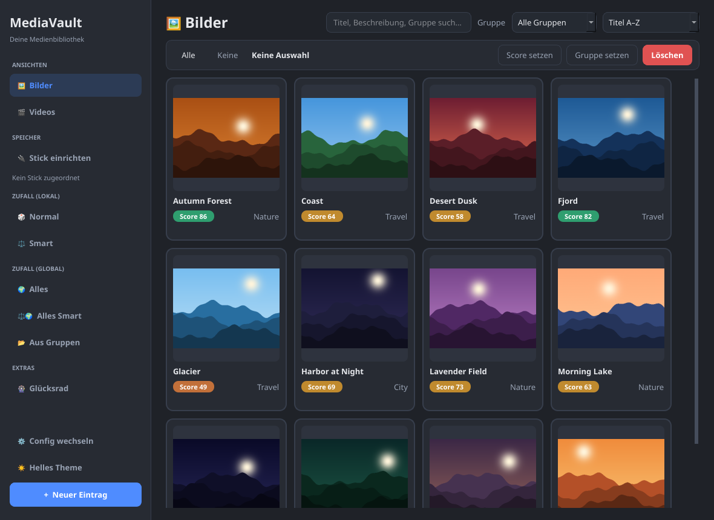
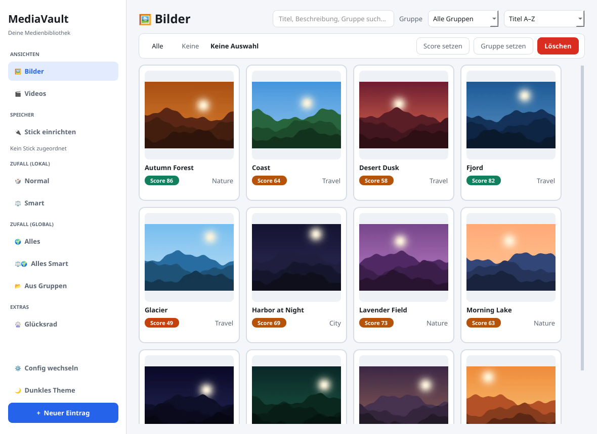
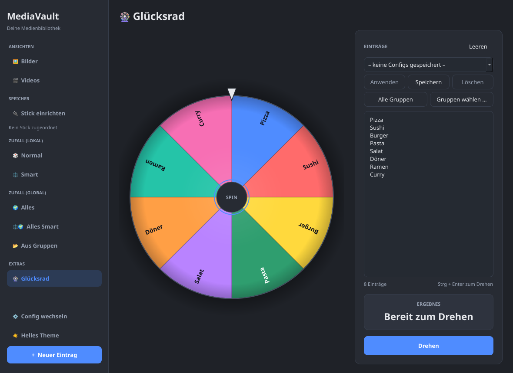

<div align="center">

# MediaVault

**A place to collect the images that matter to you, rate them, and keep rediscovering them.**

[](https://github.com/NEXT876/MediaVault/actions/workflows/ci.yml)
[](https://github.com/NEXT876/MediaVault/actions/workflows/ci.yml)
[](https://github.com/NEXT876/MediaVault/releases)
[](pyproject.toml)
[](LICENSE)



</div>

MediaVault is a desktop app for images and videos, built with Python and PyQt6.
You rate every item from 1 to 100, sort it into groups, and let MediaVault
pick something for you: at random, weighted by score, or straight from the
top of your ranking. Everything stays on your machine in a single JSON file.

> [!NOTE]
> The user interface is currently in German.

## Who it is for

### Fan art collectors

You follow a handful of artists and want their work in one place instead of
scattered across bookmarks. An import plugin fetches an artist's latest
posts, you pick the ones you like in a preview, and MediaVault downloads them
in the background, skipping anything you already have. Rate what you
collected, then rediscover it: shuffle through the whole vault, let **Smart
random** surface high-scoring pieces you have not looked at in a while, or
sort by score to see your all-time favorites.

### Photographers

You come home with hundreds of shots and need the best ten. Point a config at
the shoot's folder (local, on a USB stick, or on a cloud drive), let MediaVault
index it, and rate as you go. Groups keep shoots or subjects apart, batch
actions rate or regroup many photos at once, and sorting by score turns the
grid into a shortlist.



## Features

**Organize**
- Image and video library shown as a responsive grid of thumbnails
- Groups, full-text search (title, description, group, AI prompt) and sorting
  by title, score or last viewed
- Multi-select by click, Shift+click, rubber band or Ctrl+A, with batch
  rating, grouping and deleting
- Bulk import with duplicate detection by content hash

**Rate and rediscover**
- Scores from 1 to 100, quick rating in the detail view, rating count and
  last-rated time
- Random picks from the current view or the whole vault, optionally limited
  to chosen groups
- **Smart** mode weights picks by score, view count and time since last view
- A configurable prize wheel for everything else, with saved entry lists and
  one-click "put my groups on the wheel"

**Storage**
- Several libraries ("configs"), each with its own folder and database
- **Stick mode**: keep a library on a USB stick; paths are stored relative to
  a marker file, so a new drive letter breaks nothing
- Thumbnails are cached as WebP in `~/.mediavault/thumbs` and stay available
  while the stick is unplugged
- Works on top of `rclone mount` without downloading whole videos
  (see [Cloud storage](#cloud-storage-with-rclone))

**Extensible**
- Import sources are plugins: drop a folder into `plugins/` and it shows up
  in the sidebar (see [Plugins](#plugins))
- Reads AI generation metadata (prompt, model, seed, sampler) from PNGs and
  offers a prompt analysis

**Comfortable**
- Dark and light theme, switchable at runtime and remembered across restarts



## Installation

### Windows

A standalone `.exe` that needs no Python will be attached to the
[releases](https://github.com/NEXT876/MediaVault/releases). Until the first
release, install from source as described below.

### From source

Requires Python 3.10 or newer.

```bash
git clone https://github.com/NEXT876/MediaVault.git
```

```bash
cd MediaVault
```

```bash
pip install -e .
```

```bash
python -m mediavault
```

Plugins are loaded from the `plugins/` folder next to the package, so start
the app from the repository folder.

## Keyboard shortcuts

| Shortcut | Action |
| --- | --- |
| Click | Select or deselect a tile |
| Shift+Click | Select a range from the last clicked tile |
| Drag | Rubber-band selection across tiles |
| Ctrl+A | Select all visible tiles |
| Esc | Clear the selection |
| Delete | Delete the selected entries |
| Ctrl+F | Focus the search field |
| Double-click | Open the detail view |
| Ctrl+Enter | Spin the prize wheel |

## Plugins

An import plugin is a folder with an `__init__.py` that defines `PLUGIN`.
MediaVault discovers plugins in `plugins/` (committed) and `plugins/private/`
(local only, ignored by git) at startup. A plugin only fetches posts; the
preview, download queue and duplicate-aware import are provided by the app.
Without plugins the "IMPORT FROM WEB" section of the sidebar stays hidden.

The interface and a complete example are documented in
[plugins/README.md](plugins/README.md).

## Cloud storage with rclone

A cloud folder mounted with `rclone mount` works like any local folder.
MediaVault never reads a whole video for indexing: the duplicate hash uses
only the first and last MiB, and the thumbnail a single frame at about two
seconds. Once cached in `~/.mediavault/thumbs`, the original is not touched
again until you play it. With a mount like this, a scan downloads only a few
MB per video:

```bash
rclone mount remote:Media ~/Cloud --vfs-cache-mode full --vfs-cache-max-size 20G --vfs-read-chunk-size 8M --buffer-size 0 --dir-cache-time 1h
```

- `--vfs-cache-mode full` caches only the chunks that were read, not whole files
- `--vfs-read-chunk-size 8M --buffer-size 0` prevents large read-ahead during
  the thumbnail scan
- `--vfs-cache-max-size` caps the local space used by watched videos
- Images are read in full for their thumbnail (usually small, so harmless)
- File managers such as Nautilus or Dolphin create their own thumbnails and
  download far more; turn those off for network or FUSE folders
- After the first scan, `du -sh ~/.cache/rclone/vfs` shows how much was
  actually downloaded

## Project structure

Three layers, from the inside out: **data classes** (`models/`) depend on
nothing else, the **logic** (modules directly in `mediavault/`) works without
Qt, and the **GUI** (`gui/`) wires everything together. Optional extras such
as the prize wheel live in `extras/` and are only used by the main window.
Boundary tests (`test_models_boundary.py`, `test_extras_boundary.py`) keep
these rules in place.

```
mediavault/
├── __main__.py         # entry point, splash screen
├── models/             # plain data classes, import nothing from the app
│   ├── media.py        # MediaItem, MediaType
│   ├── vault.py        # VaultConfig, LibraryRoot, VolumeInfo, modes
│   ├── results.py      # ImportResult, CopyResult, DownloadResult
│   └── posts.py        # RemotePost, FetchResult (plugin data)
├── config.py           # load/save configs, database paths, stick lookup, logging
├── database.py         # MediaDatabase: loading, atomic saving, random picks
├── library.py          # filtering/sorting for the grid, folder indexing
├── importer.py         # import with duplicate detection
├── scanner.py          # find new media in a folder
├── transfer.py         # copy files into the library folder
├── volumes.py          # stick marker and relative paths
├── ai_meta.py          # read AI metadata (prompt, seed, model) from PNGs
├── plugins.py          # plugin interface and discovery
├── remote.py           # download and import plugin posts
├── media_preview.py    # video frames and system thumbnails
├── extras/             # optional extras, not part of the core
│   └── wheel/          # prize wheel
│       ├── page.py         # wheel and page with editor and result
│       ├── group_dialog.py # put library groups on the wheel
│       └── configs.py      # saved entry lists
└── gui/
    ├── main_window.py  # main window: wires sidebar, grid, dialogs, extras
    ├── sidebar.py      # navigation and status
    ├── card_grid.py    # tile grid, selection, background thumbnail loading
    ├── thumbnails.py   # create thumbnails, WebP cache in ~/.mediavault/thumbs
    ├── worker.py       # background thread for one blocking task
    ├── selection.py    # rubber band with auto-scroll
    ├── widgets.py      # media tiles, button and label helpers
    ├── collapsible.py  # collapsible sidebar section
    ├── folder_sync.py  # folder sync with preview and import
    ├── plugin_import.py  # plugin import: settings, fetching, queueing
    ├── preview_dialog.py # pick fetched posts
    ├── downloads.py    # download queue
    ├── stick_banner.py # offer to set up a newly plugged-in stick
    ├── stick_dialog.py # bind a config to a folder on a stick
    ├── dialogs.py      # detail, edit, random and config dialogs
    ├── file_dialogs.py # native file pickers, opening files
    └── theme.py        # dark/light palettes and QSS
tests/
plugins/                # import plugins; private/ is not committed
```

## Contributing

Set up a development install:

```bash
pip install -e ".[dev]"
```

```bash
QT_QPA_PLATFORM=offscreen pytest -q
```

```bash
ruff check mediavault tests
```

- `develop` is the working branch; `main` only receives releases (one squash
  commit per release).
- Branch names start with their type: `feature/`, `fix/`, `refactor/`,
  `docs/`, `test/`, `chore/` (for example `feature/duel-mode`).
- Pull requests target `develop`, use the template and name the type in the
  title (`Feature: …`, `Fix: …`, `Refactor: …`). GitHub squashes on merge, so
  the title becomes the commit message.
- CI (Ruff and tests) runs on every pull request; the release pull request
  into `main` also updates the coverage badge.

## License

[MIT](LICENSE) © Ben Waibel
