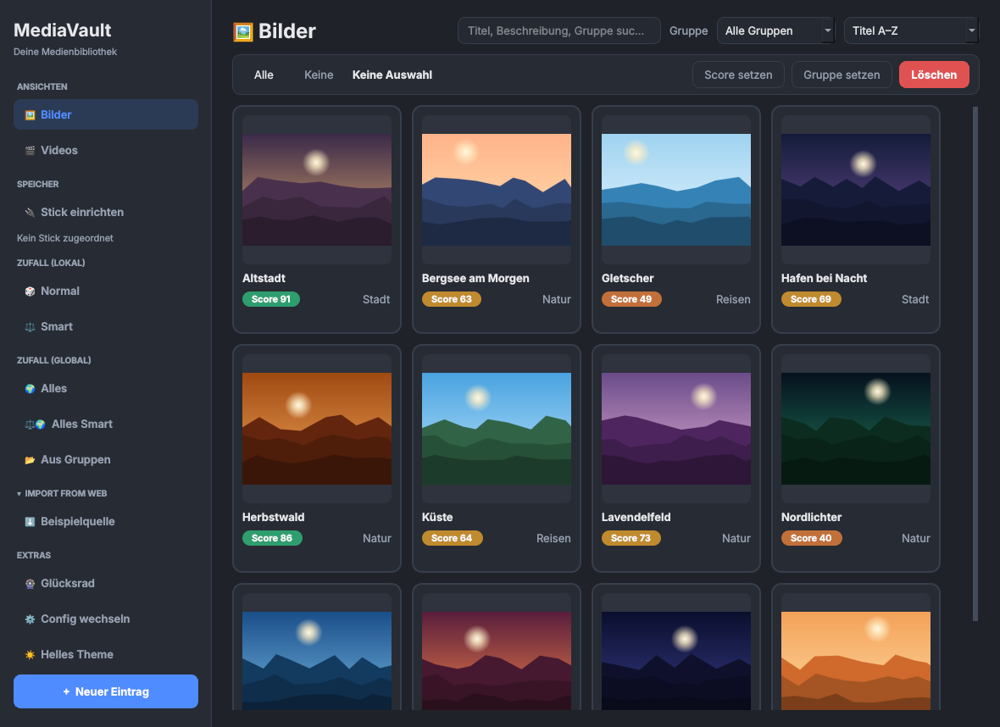

# MediaVault

[](https://github.com/NEXT876/MediaVault/actions/workflows/ci.yml)
[](https://github.com/NEXT876/MediaVault/actions/workflows/ci.yml)

Ein Desktop-Tool zum Verwalten, Bewerten und Durchstöbern von Medien (Bilder und Videos) – mit Bewertungssystem, Zufallsauswahl und Batch-Funktionen.



## Überblick

MediaVault ("Media Score Tracker") ist eine PyQt6-basierte Desktop-Anwendung, mit der du deine Bilder- und Videosammlung organisierst, bewertest und per Zufall durchstöbern kannst. Alle Einträge werden in einer lokalen JSON-Datei (`~/.mediavault/media_data.json`) gespeichert. Die Oberfläche bietet ein modernes Dark- und Light-Theme.

## Features

- **Medienverwaltung**: Bilder und Videos als Kacheln (Grid) anzeigen, anlegen, bearbeiten und löschen
- **Mehrfachauswahl**: Klick toggelt eine Kachel, Shift+Klick wählt einen Bereich, Strg+A wählt alles, ein aufgezogenes Rechteck markiert mehrere Kacheln auf einmal; Esc hebt die Auswahl auf
- **Suche & Sortierung**: Volltextsuche über Titel, Beschreibung, Gruppe und KI-Prompts sowie Sortierung nach Titel, Score oder zuletzt angesehen
- **Bewertungssystem**: Medien mit einem Score (1–100) bewerten; Bewertungsanzahl und Zeitpunkt der letzten Bewertung werden erfasst
- **Detailansicht**: Vorschaubild, Statistiken, Beschreibung, direkte Wiedergabe/Öffnen sowie Schnellbewertung über die Buttons `1`–`5` (Doppelklick auf eine Kachel öffnet die Details)
- **Zufallsauswahl**: Lokaler und globaler Zufall, inkl. "Smart"-Modus (gewichtet nach Score, Aufrufen und letzter Wiedergabe) sowie Zufall innerhalb ausgewählter Gruppen
- **Batch-Aktionen**: Mehrfachauswahl zum gleichzeitigen Bewerten, Gruppieren und Löschen
- **Massenimport**: Mehrere Bilder oder Videos auf einmal importieren (Duplikate werden übersprungen)
- **Thumbnails**: Automatische Vorschaubilder über OS-Thumbnails (nur Linux) bzw. extrahierte Videoframes (via OpenCV); einmal erzeugte Vorschauen liegen als WebP in `~/.mediavault/thumbs` und sind auch ohne Stick da
- **Stick-Modus**: USB-Stick einstecken, `🔌 Stick einrichten` öffnen, Ordner wählen – entweder als neue Config anlegen oder die aktive Config darauf umstellen. Referenzen werden relativ zur Stick-Identität gespeichert (Marker-Datei `.mediavault-vault`), damit ein anderer Laufwerksbuchstabe nichts kaputt macht
- **Kopieren beim Hinzufügen**: Bilder und Videos, die von Hand importiert werden, kopiert die App in den Ordner der aktiven Config
- **Glücksrad**: Unter `🎡 Glücksrad` eigene Einträge (eine Zeile pro Option) eingeben und per Klick, Button oder Strg+Enter drehen – passt sich dem aktiven Theme an. Eintragslisten lassen sich als Configs speichern, anwenden und löschen (`~/.mediavault/wheel_configs.json`); mit einem Klick landen alle oder ausgewählte Gruppen der Bibliothek auf dem Rad (mit Warnung, falls die aktuellen Einträge noch nicht als Config gespeichert sind)
- **Responsive Grid**: Die Kachelansicht passt die Spaltenanzahl automatisch an die Fenstergröße an
- **Themes**: Dark und Light live umschaltbar; die Auswahl bleibt über Neustarts erhalten
- **Import from Web**: Importquellen sind Plugins (siehe [Plugins](#plugins)). Jedes installierte Plugin bekommt einen Eintrag im zuklappbaren Bereich „IMPORT FROM WEB“ der Seitenleiste; ohne Plugins ist der Bereich ausgeblendet

## Tastenkürzel

| Kürzel | Aktion |
| --- | --- |
| Klick | Kachel aus-/abwählen |
| Shift+Klick | Bereich ab der zuletzt angeklickten Kachel auswählen |
| Ziehen | Auswahlrechteck über mehrere Kacheln |
| Strg+A | Alle sichtbaren Kacheln auswählen |
| Esc | Auswahl aufheben |
| Entf | Ausgewählte Einträge löschen |
| Strg+F | Suche fokussieren |
| Doppelklick | Detailansicht öffnen |

## Projektstruktur

Drei Schichten, von innen nach außen: **Datenklassen** (`models/`) kennen
nichts anderes, die **Logik** (Module direkt in `mediavault/`) kommt ohne Qt
aus, die **Oberfläche** (`gui/`) verdrahtet alles. Optionale Extras wie das
Glücksrad liegen in `extras/` und werden nur vom Hauptfenster eingebunden.
Tests (`test_models_boundary.py`, `test_extras_boundary.py`) halten diese
Grenzen fest.

```
mediavault/
├── __main__.py        # Einstiegspunkt, Splash-Screen
├── models/            # Reine Datenklassen ohne Logik, importieren nichts aus der App
│   ├── media.py       # MediaItem, MediaType
│   ├── vault.py       # VaultConfig, LibraryRoot, VolumeInfo, Modi
│   ├── results.py     # ImportResult, CopyResult, DownloadResult
│   └── posts.py       # RemotePost, FetchResult (Plugin-Daten)
├── config.py          # Configs laden/speichern, Datenbankpfade, Stick-Auflösung, Logging
├── database.py        # MediaDatabase: Laden, atomares Speichern, Zufallsauswahl
├── library.py         # Filtern/Sortieren fürs Raster, Ordner indexieren
├── importer.py        # Import mit Duplikaterkennung
├── scanner.py         # Neue Medien in einem Ordner finden
├── transfer.py        # Dateien in den Mediathek-Ordner kopieren
├── volumes.py         # Stick-Marker und relative Pfade
├── ai_meta.py         # KI-Metadaten (Prompt, Seed, Modell) aus PNGs lesen
├── plugins.py         # Plugin-Schnittstelle und -Erkennung
├── remote.py          # Downloads und Import von Plugin-Posts
├── media_preview.py   # Videoframes und System-Thumbnails
├── extras/            # Optionale Extras, nicht Teil des Kerns
│   └── wheel/         # Glücksrad
│       ├── page.py    # Rad und Seite mit Editor und Ergebnis
│       ├── group_dialog.py # Gruppen der Bibliothek aufs Rad
│       └── configs.py # Gespeicherte Eintragslisten
└── gui/
    ├── main_window.py # Hauptfenster: verdrahtet Seitenleiste, Raster, Dialoge, Extras
    ├── sidebar.py     # Seitenleiste mit Navigation und Statusanzeigen
    ├── card_grid.py   # Kachelraster, Auswahl, Vorschauen im Hintergrund laden
    ├── thumbnails.py  # Vorschaubilder erzeugen, WebP-Cache in ~/.mediavault/thumbs
    ├── worker.py      # Hintergrund-Thread für eine blockierende Aufgabe
    ├── selection.py   # Auswahlrechteck mit Auto-Scroll
    ├── widgets.py     # Medienkacheln, Button- und Label-Helfer
    ├── collapsible.py # Einklappbare Seitenleisten-Sektion
    ├── folder_sync.py # Ordner-Sync mit Vorschau und Import
    ├── plugin_import.py # Plugin-Import: Einstellungen, Posts holen, einreihen
    ├── preview_dialog.py # Auswahl der geholten Posts
    ├── downloads.py   # Download-Warteschlange
    ├── stick_banner.py # Angebot, einen neuen, noch ungenutzten Stick einzurichten
    ├── stick_dialog.py # Config an einen Ordner auf dem Stick binden
    ├── dialogs.py     # Detail-, Bearbeiten-, Zufalls- und Config-Dialoge
    ├── file_dialogs.py # Native Dateiauswahl, Dateien öffnen
    └── theme.py       # Dark-/Light-Paletten und QSS
tests/
plugins/               # Import-Plugins, private/ wird nicht eingecheckt
```

## Start

Python 3.10 oder neuer. Aus dem Repository-Ordner:

```bash
pip install -e .
```

```bash
python -m mediavault
```

Abhängigkeiten: `PyQt6`, `opencv-python` (für Videovorschauen). Plugins werden
aus `plugins/` neben dem Paket geladen, deshalb die App aus dem Repository
starten.

## Entwicklung

```bash
pip install -e ".[dev]"
```

```bash
QT_QPA_PLATFORM=offscreen pytest -q
```

```bash
ruff check mediavault tests
```

- `develop` ist der Arbeitsstand, `main` enthält nur Releases (ein Squash-Commit
  pro Release, siehe CI unten).
- Branches beginnen mit ihrer Art: `feature/`, `fix/`, `refactor/`, `docs/`,
  `test/`, `chore/` (z. B. `feature/duel-mode`).
- PRs gehen nach `develop`, nutzen die Vorlage und nennen den Typ im Titel
  (`Feature: …`, `Fix: …`, `Refactor: …`). GitHub squasht beim Merge automatisch
  (der PR-Titel wird zur Commit-Message) und löscht den Branch danach.
- Commits direkt auf `develop` beginnen ebenfalls mit dem Typ (`Fix: …`, `Docs: …`).
- Die CI (Ruff und Tests) läuft beim Release-PR von `develop` nach `main` und
  bei Pushes auf `main`.

## Plugins

Importquellen liegen als Ordner in `plugins/` (eingecheckt) oder
`plugins/private/` (nur lokal, von git ignoriert). Installieren heißt: Ordner
hineinkopieren und die App neu starten. Wie man ein Plugin schreibt, steht in
[plugins/README.md](plugins/README.md).

## Cloud-Speicher mit rclone

Ein Cloud-Ordner lässt sich mit `rclone mount` wie ein lokaler Ordner einbinden und dann ganz normal als Speicherort auswählen. MediaVault liest von Videos nie die ganze Datei: Der Hash nimmt nur die erste und letzte MiB, die Vorschau nur einen Frame bei etwa 2 Sekunden. Fertige Vorschauen liegen danach in `~/.mediavault/thumbs`, das Original wird dafür nicht mehr angefasst. Mit dem passenden Mount lädt rclone deshalb beim Scan nur wenige MB pro Video, das ganze Video erst beim Abspielen:

```bash
rclone mount remote:Medien ~/Cloud --vfs-cache-mode full --vfs-cache-max-size 20G --vfs-read-chunk-size 8M --buffer-size 0 --dir-cache-time 1h
```

- `--vfs-cache-mode full` speichert nur die gelesenen Stücke lokal, nicht die ganzen Dateien
- `--vfs-read-chunk-size 8M --buffer-size 0` verhindert großes Vorauslesen beim Vorschau-Scan
- `--vfs-cache-max-size` begrenzt den Platz, den angeschaute Videos lokal belegen
- Bilder werden für die Vorschau komplett geladen (meist klein, also unkritisch)
- Dateimanager wie Nautilus oder Dolphin erzeugen beim Öffnen des Ordners eigene Vorschauen und laden dabei viel mehr – dort die Vorschau für Netz-/FUSE-Ordner abschalten
- Prüfen: Nach dem ersten Scan zeigt `du -sh ~/.cache/rclone/vfs`, wie viel tatsächlich geladen wurde
